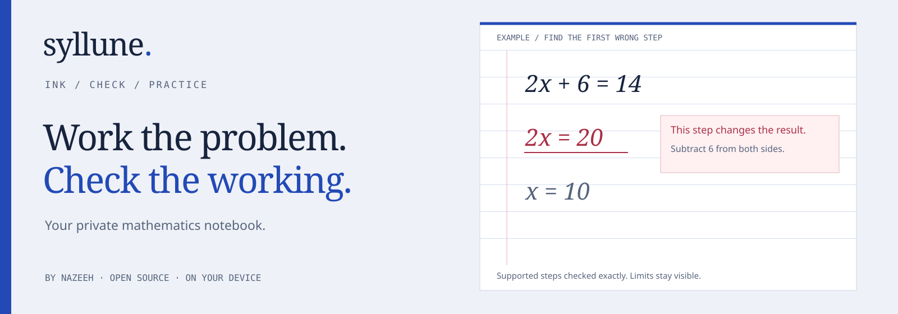
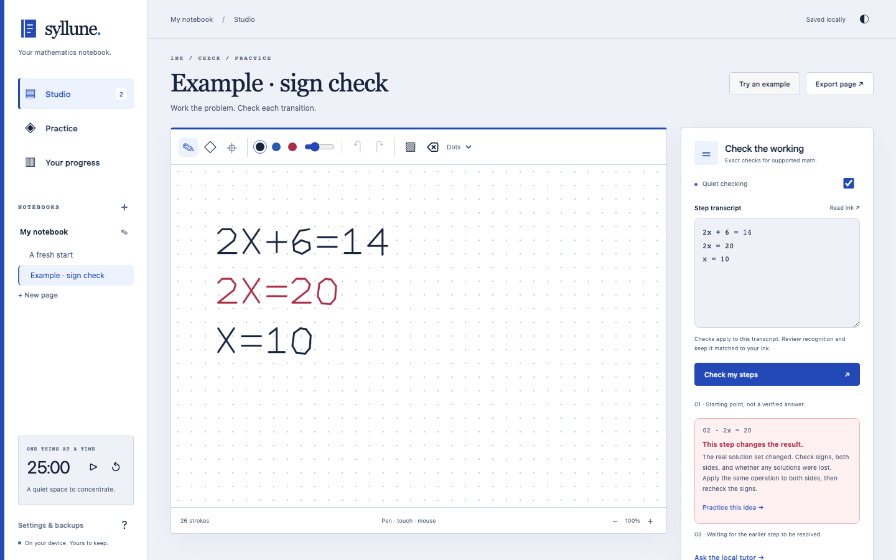
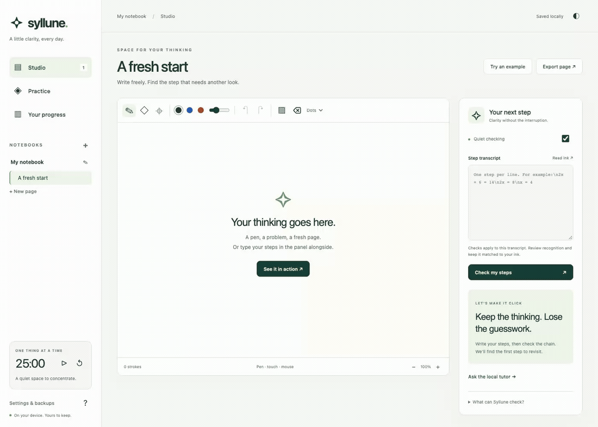
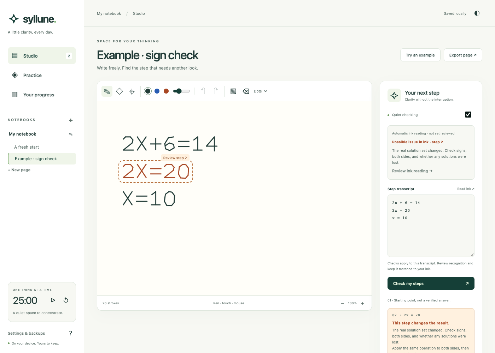
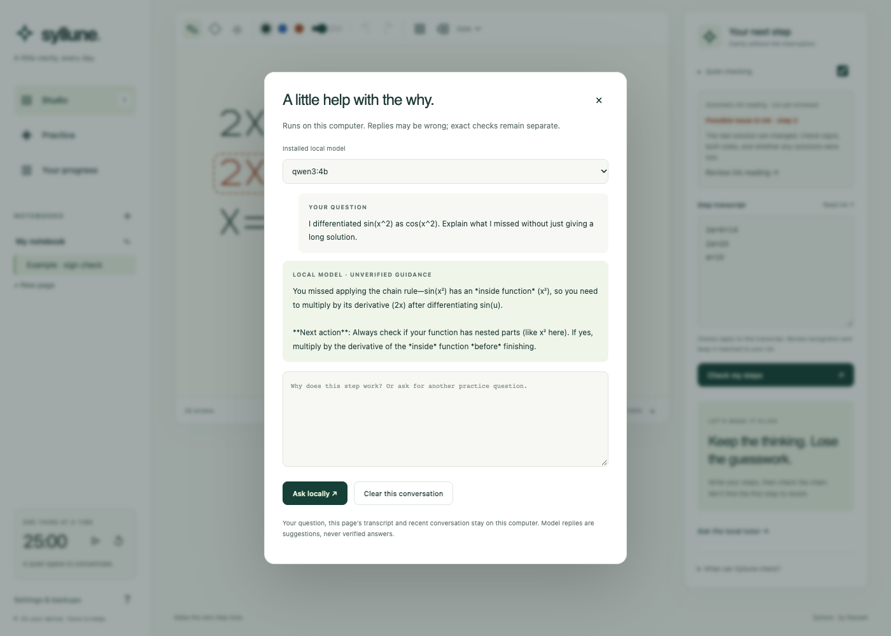

<p align="center"></p>

<p align="center"><a href="https://nazeeh111.github.io/Syllune/">Open the current studio</a> · <a href="#start-in-seconds">Run current source</a> · <a href="https://github.com/nazeeh111/Syllune/releases/tag/v1.0.0">Download v1.0.0</a> · <a href="docs/CHECKING.md">Checking guide</a> · <a href="docs/PRIVACY.md">Privacy & recovery</a></p>
<p align="center"><a href="https://github.com/nazeeh111/Syllune/actions/workflows/release.yml"></a>  </p>

**Syllune is a private math studio by Nazeeh.** Write by hand, keep your thinking intact, and find the first step that needs another look. Turn that moment into a useful practice session.

The hosted studio and current source checkout have the notebook interface shown below. The v1.0.0 download has the earlier appearance recorded in the workflow GIF.

<p align="center"></p>

<p align="center"></p>

### A studio that stays out of your way

- **Ink that belongs to you.** Pressure-aware pen, eraser, selection and movement, undo/redo, paper styles, images and page zoom. Organize notebooks and rename pages.
- **Checks you can inspect.** Exact arithmetic compares supported steps, locates the first incorrect or unverified transition, explains the limit, and leaves later work untouched.
- **Practice with a purpose.** Five topic families, progressive hints, worked solutions, real attempt history and spaced review dates. Mistakes lead directly to a relevant topic.
- **On-device recognition.** The optional Mac companion uses Apple Vision. Review its editable transcript before checking. No model key, paid API or cloud upload.
- **A durable workspace.** Local autosave, a single saving tab, validated backups, non-destructive imports, PNG export and browser Print / PDF. Corrupt storage pauses saving and preserves original bytes.
- **Quiet by design.** After a writing pause, the Mac companion reads ink and marks possible issues without replacing your transcript. Review the reading before adopting it. Typed checks, focus timer, themes, keyboard controls and offline use remain available.
- **Help with the why.** An optional local tutor uses an installed Ollama text model for broader math explanations and follow-up practice. Its replies are labeled unverified guidance and saved with your page.

### Start in seconds

The [hosted studio](https://nazeeh111.github.io/Syllune/) works immediately with ink, typed checks and practice. An account is unnecessary. Install it using your browser’s app/install option when supported.

For the local companion, install **Node.js 22 or newer**, then:

```sh
git clone https://github.com/nazeeh111/Syllune.git
cd Syllune
npm start
```

Open **http://127.0.0.1:4319**. No `npm install` is needed to run the app.

Mac recognition additionally needs macOS with Apple Vision and Xcode Command Line Tools (`xcode-select --install`). Click **Read ink**, check the recognized symbols, then **Check my steps**. The first recognition request compiles the small native helper locally. Windows and Linux support the complete ink/typed-check/practice workflow; native recognition is unavailable there. The hosted app does not connect to your localhost companion.

### Quiet ink, with uncertainty visible

Write, then pause. The Mac companion reads the page locally and highlights an OCR-derived region when a supported transition looks wrong. A possible issue is a suggestion about recognized text, not a proven verdict on your handwriting. New strokes, transcript edits and page changes discard stale reads. Your existing transcript is preserved until **Review ink reading → Use reviewed transcript**.



### A local tutor for the next question

For broader explanations, run the local companion and [Ollama](https://ollama.com/) with an installed local text model. Open **Ask the local tutor**, select the model, and ask your question. For example, Qwen can help explain a missed chain-rule factor or suggest another exercise. No model is downloaded automatically. Thinking models may take longer to return a final answer; the studio stays usable if you close the panel while it runs. Pending questions are saved with the page. A reply that exceeds the two-minute deadline reports a timeout without discarding the question.

You can use an existing local model, or explicitly download one yourself:

```sh
ollama pull qwen3:4b
OLLAMA_NO_CLOUD=1 ollama serve
```

The example model occupies about 2.5 GB in the tested installation. Model choice is yours; Syllune lists compatible installed models. If Ollama is already running, use that local service instead of starting another. The tested service was Ollama 0.34.4. No model weights are included in this repository.

Questions, this page’s transcript and recent conversation go only to the fixed loopback Ollama endpoint. Remote/cloud model metadata is rejected. The model’s response is **fallible guidance**, separate from exact checking. Your per-page conversation is included in JSON backups. The hosted app does not provide the local tutor.



### What a check means

Syllune supports exact rational arithmetic, polynomial expressions in **x** through degree 8, linear and quadratic equations over the real numbers, and polynomial derivatives written as `d/dx(...)`.

```text
2x + 6 = 14
2x = 8
x = 4
```

Both transitions hold. Changing the second line to `2x = 20` flags that line. `x^2 = 4` followed only by `x = 2` flags a lost solution; use `x = -2 or x = 2`.

**Unverified means unverified.** General trigonometry, variable denominators, inequalities, multiple variables and nonproportional higher-degree equations need a broader solver. Syllune compares the lines you provide; it does not prove that the starting problem was transcribed correctly. OCR confidence is not mathematical certainty. Read [the full checking guide](docs/CHECKING.md).

### Keep your work portable

Use **Settings & backups → Export backup** before clearing browser data or changing devices. Import adds copies of notebooks and retains existing notebooks. PNG export contains ink and images; Print / PDF uses the current page. Hosted and local studios have separate browser storage. Private browsing and storage quotas can limit persistence. See [privacy and recovery](docs/PRIVACY.md).

The workflow GIF and local OCR/tutor captures above were recorded in 1.0.0. The current notebook screenshot reflects the 1.0.1 visual update.

### Develop and verify

```sh
npm test
npm run check
# Optional browser test tooling:
npm ci
npx playwright install chromium
npm run test:browser
```

`npm test` covers exact checking, all 504 generator seed residues across five topics, backup validation, stale-save protection and local HTTP boundaries. The browser suites exercise drawing/history/selection, images, exports, persistence, practice, backup import, multi-tab protection, malformed-storage recovery, offline checking and mobile layout. Fixture transports also test quiet-reading cancellation, explicit adoption, OCR/tutor concurrency and saved conversation labels; real native OCR and a local Qwen reply were separately exercised. GitHub Actions repeats these checks before publishing Pages. See [verification evidence](docs/VERIFICATION.md).

```text
web/engine.js       exact rational polynomial checker
web/ink.js          pressure ink, selection and page history
web/storage.js      bounded versioned snapshots and safe imports
web/practice.js     exercises, hints and review scheduling
web/quiet-ink.js    cancellable, uncertain ink-read suggestions
local-tutor.mjs     bounded installed-local-model guidance
web/app.js          accessible studio flows and writer lock
server.mjs          localhost server and bounded recognition API
native/Recognize.swift  on-device Apple Vision helper
```

Created by **Nazeeh**. Source and original visual assets are available under [MIT](LICENSE). Playwright is development-only tooling under Apache-2.0; Apple Vision is a system framework supplied with macOS. Optional Ollama/models retain their own licenses; model weights are not bundled.
